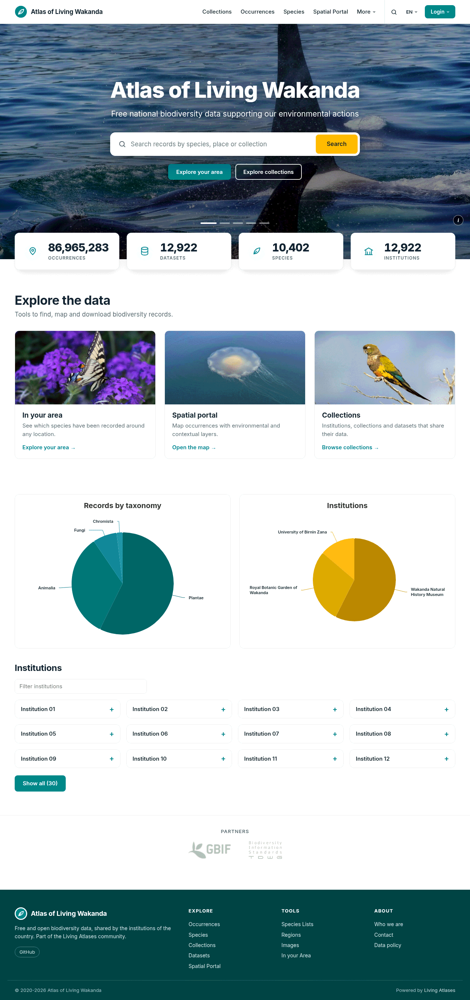
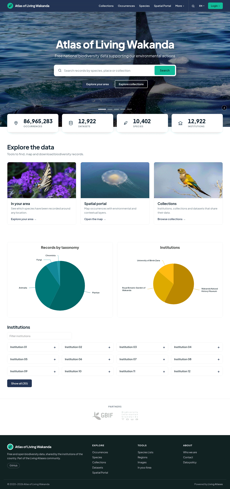
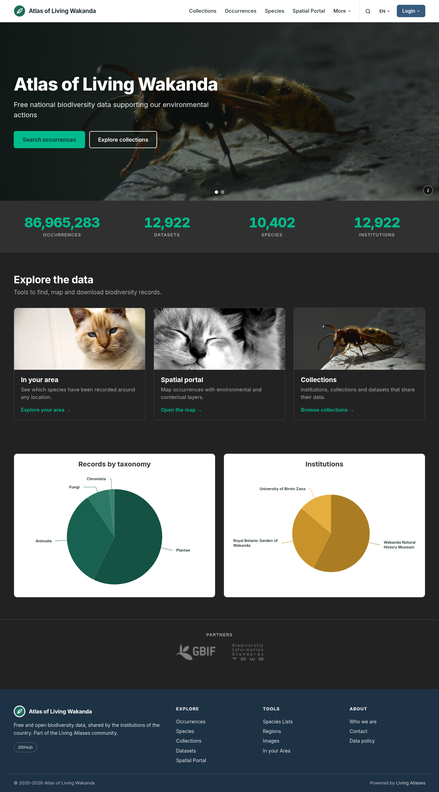
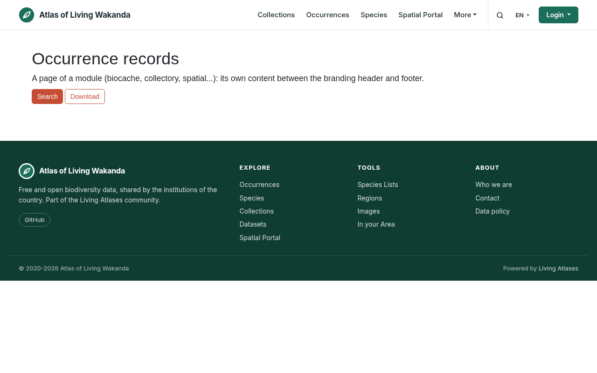
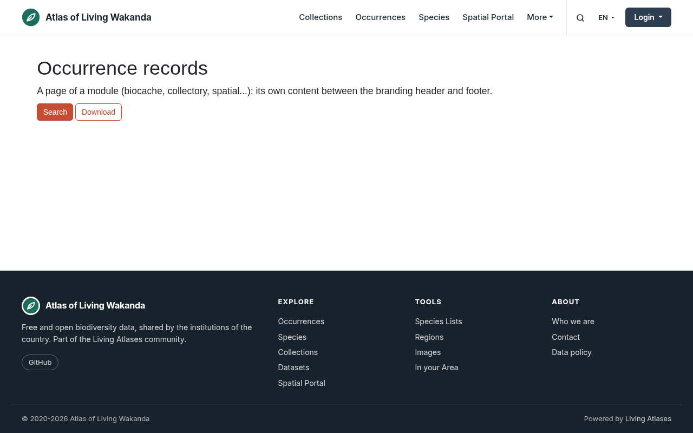
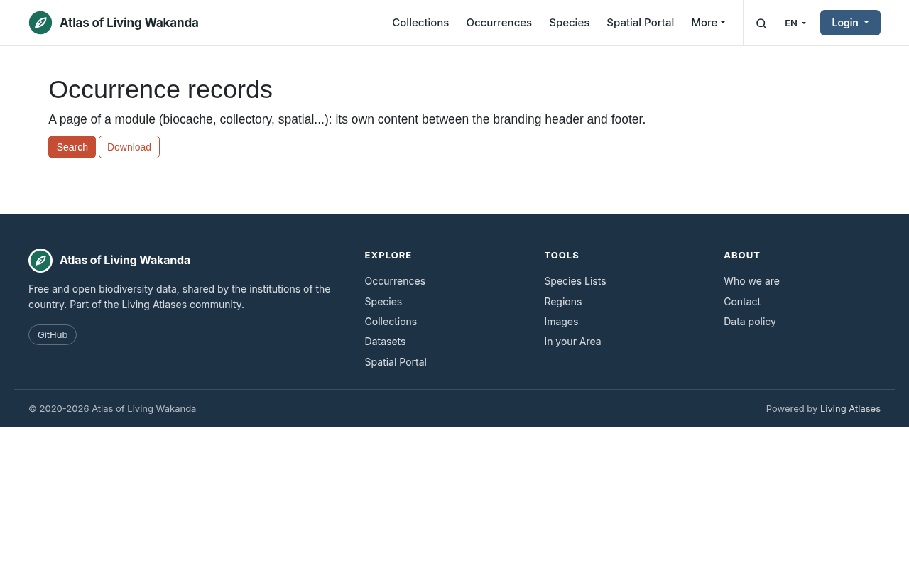

## Introduction

This is a base branding for new Living Atlas deployments. That is, some ALA header, banner and footer theme with:

- Good integration with ALA modules trying to avoid jquery conflicts and similar
- Good integration with `CAS` Authentication
- Multilingual
- Modern javascript code without lost of compatibility with old browsers
- Digest usage for skip cache old js/css when we release a new version

You can use this as a basis for a new LA infrastructure branding or just to see how you can integrate your branding with ALA dependencies, etc.

## Strategy 

A LA compatible branding consist (currently) in a Bootstrap v3 footer and header html/css/js files that are loaded by all ALA java modules. But also some resources (like fonts, js/css dependencies, etcetera) are loaded from this branding (like jQuery or Bootstrap). 

In other words, we can have our custom html with our custom look & feel, image, css, menus, and still we need to put in our branding some common libs and resources that should be loaded by the ALA modules (like bootstrap, jquery and other js libs).

Our strategy is to keep our brandings in sync with these dependencies easily. For this we just copy all that resources from the [ALA current branding](https://github.com/AtlasOfLivingAustralia/commonui-bs3-2019/) that is included in this repository as a [git submodule](https://github.com/living-atlases/base-branding/blob/master/.gitmodules) and their resources are copied on each build (See the `vite.config.js`). With the same strategy the LA branding includes their [WP theme](https://github.com/AtlasOfLivingAustralia/commonui-bs3-2019/) as a submodule, so, if they change some css in the WP theme, their branding is also updated.

```
This base branding ---- uses ---> ALA branding resources ---- uses ----> ALA WP theme resources
```

For instance, to avoid conflicts, we only load js libs that are not used by ALA (like `i18next` js lib) and we use the libs that ALA already include in their branding and software (as the jQuery lib or the Boostrap 3 framework and deps).

The goal is also not to deal with [duplicate code and their problems](https://en.wikipedia.org/wiki/Duplicate_code).

So if ALA fix some js error, or if add a new chart lib, or similar, we can include that changes in our build easily. 

This is how the `base-branding` includes the ALA theme code in the build process (see (See the `vite.config.js`):


The branding also create a homepage, a test page and an error page. But if you need some more complex homepage, and for instance, you need to use a CMS (like Wordpress), our recommendation is that you can use a similar strategy to avoid the need of keed in sync your LA branding and your CMS theme. So you can develop a common header/footer and css styling in your CMS, and include it in a fork of this sample branding. In summary:

```
Your branding ---- uses ---> ALA branding resources ---- uses ----> ALA WP theme resources
              `--- uses ---> you CMS theme resources
```

So if for instance, you change a logo or a footer link in your CMS you can have the same change in your LA portal easily. For that you need to include it a submodule and also copy your resources in `vite.config.js` during the build like we do with the ALA resources. 

Also in general we try not to mix libs versions like different Boostrap or jQuery versions.

Other strategy is to have an independent CMS theme with their own js/css and a simpler LA branding with a similar look a feel but using ALA libs (Bootstrap 3 ...).

## Styling

ALA uses Bootstrap 3 in most of their modules and Bootstrap 5 in the newer ones. This branding builds both (`npm run build`), and both share the same look: a thin white header with the logo and name on the left and the menu, search, language and login on the right, and a footer of several columns. The home page has a full-bleed hero carousel with image credits, big numbers, cards, optional charts and a strip of partners.

Themes live in `app/themes`. `clean` is the default and the base of the [Bootswatch 3](https://bootswatch.com/3/) themes (`cosmo`, `darkly`, `flatly`, `paper`, `sandstone`, `simplex`, `slate`, `superhero`, `yeti`): each one loads its `bootstrap.min.css` and has its own look: brand and navbar colours, a font and a corner radius (`presets` in `app/js/utils/brand.js`). Pick one with `theme` in `app/js/settings.js`. The Bootstrap 5 build has no Bootswatch: it takes the colours of the theme you pick.

The experimental `material` theme is discontinued: a `theme: 'material'` now builds as `clean`.

## Customize the look

Everything is in `app/js/settings.js`; the texts are in the locales (`app/assets/locales/<lang>/common`). A fork usually only touches these two files and its images.

| What | Where |
|---|---|
| Colours, fonts, logo | `brand`: `colors.primary` (links, buttons), `colors.primaryDark` (footer), `colors.accent` (search button), `colors.highlight` (big numbers, card links; primary by default), `colors.headerBg` (header; its text and accent colours follow from it, or set `headerInk` and `headerAccent`), and `ink`, `muted`, `line`, `surface`, `page` (text and page colours); `font` and `headingFont`; `radius` (px); `logo`, `logoWide` (a wide logo keeps its proportions) and `footerLogo` (a version for the footer background, shown without the white box) |
| Hero | `home.hero.slides`: `image`, `position` (CSS background-position, for narrow screens) and its credits (`species`, `institution`, `author`, `license`, `licenseUrl`, `recordUrl`). For sharp images on every screen, `image` can have a `{w}` with the `widths` it comes in and its `ratio` (width / height), plus a `narrow` cut for phones (`image`, `widths`, `ratio`): each visitor gets the smallest one that covers the hero. `home.hero.search` (`url`, `param`, or `false`); `home.hero.buttons`; `home.hero.interval` |
| Languages | `enabledLangs`: the header language menu lists these, and is left out with a single language |
| Cards and partners | `home.cards` (`i18n` key, `image`, `url`), `home.partners` (`name`, `logo`, `url`) |
| Home widgets | `homeWidgets`: `stats`, `taxoChart`, `instChart`, `institutions` (true/false, all true by default); `dataHub`: `null` for the whole portal or a data hub uid; `dataHubToFlag` and `flagBadge`; `institutionsExclude`, `institutionsShow`; `chartColors` |
| Footer | `footer.links` (last column, `i18n` key and `url`), `footer.social` (`name`, `url`) |
| Texts | `general.orgfullname` (the home title), `general.brandname` (next to the logo, a shorter one if the full name is long), `index.*`, `footer.*` and `nav.*` keys of the locales |

Every key of `brand` is optional: what you leave out comes from the theme. Text colours on the header, buttons and accent are picked for contrast (white or dark). The sample photos come from GBIF records, with their licences in `app/assets/images/CREDITS.md`; `npm run demo` builds every theme into `demo/` to compare them (it has a colour picker to try another primary). URLs can use `{biocache}`, `{collectory}`, `{spatial}`... (any of `services`) and `{central}` (`mainLAUrl`); images are paths of this branding (`images/x.png`) or absolute URLs.

How it works:
- `scripts/branding.mjs` writes `css/la-tokens.css` from `settings.brand`: the `--la-*` CSS custom properties that the header, footer, home and widgets use, in both builds. Use them in your own CSS too (`color: var(--la-primary)`). The same file gives the Bootstrap buttons of the module pages (`btn-primary`, `btn-default`/`btn-secondary`, the outline ones, pagination) the brand colours in `clean` and in the Bootstrap 5 build, whose base CSS has the ALA ones; the Bootswatch themes keep their own.
- The header and footer CSS (`app/themes/clean/css/la-brand.css`, `la-header-bs3.css` and `app/bs5/branding-bs5.css`) reaches every page of every module and CAS, so all of it stays under the `la-*` classes, and sizes are in px because the modules set different `html { font-size }`.
- The footer is one file for both builds: `app/themes/clean/assets/footer.html`. On pages shorter than the window, `app/js/footer-bottom.js` moves it down to the bottom (by its top margin only: no `html`/`body` CSS, which would fight the module layouts). The Bootstrap 3 header is `app/themes/clean/assets/banner.html`, the Bootstrap 5 one `app/bs5/banner.mustache`: keep their menus in step.
- The home is `app/themes/clean/assets/indexBody.html`, filled by `app/js/home/` (hero carousel, cards, partners) and `app/js/widgets/` (numbers, charts, institutions). Credits and names from the APIs are written as text, never as HTML.
- The charts load Highcharts 11 from `js/highcharts/` only when they draw, so a portal without them doesn't download it. Highcharts stays on 11.x: 12 breaks the drilldown (`tests/e2e/home.spec.js` checks it).

### Optional home widgets

All four are on by default; set a key of `homeWidgets` to `false` to turn one off. Each one draws only when its container is on the page (`indexBody.html` has all of them; module pages have none, so they do nothing there). The section around the charts (`.la-widgets`) stays hidden until one of them draws.

| `homeWidgets` key | Container | What it shows | Reads |
|---|---|---|---|
| `stats` | `#stats_occurrences`, `#stats_datasets`, `#stats_species`, `#stats_institutions` | Big numbers, counting up | biocache `occurrences/search?pageSize=0` (records, species); collectory `ws/dataResource/count` and `ws/institution/count`, or `ws/dataHub/<uid>` with a data hub |
| `taxoChart` | `#taxo-container` | Pie of records by kingdom; a click drills down to species, and a button opens the records of that level | biocache `breakdown.json` |
| `instChart` | `#inst-container` | Pie of records by institution; a click opens their records | biocache `occurrence/facets` (`institution_uid`) |
| `institutions` | `#accordion-home-institutions` | Institution cards; opening one lists its collections and data resources | collectory `ws/institution`, `ws/institution/<uid>`, `ws/collection/<uid>` |

- `dataHub`: `null` counts the whole portal; a data hub uid (`'dh1'`) limits every widget to that hub (`q=data_hub_uid:<uid>`, and only its member institutions).
- `dataHubToFlag` and `flagBadge` (`image`, `title`, `url`): institutions of that other hub get a badge in the institution cards (a text pill when there is no `image`).
- `institutionsExclude`: institution uids left out of the cards. `institutionsShow` (12 by default): cards shown before a "show all" button; a longer list also gets a filter by name.
- `chartColors` (`taxo`, `inst`): base colour of each pie, `#hex` or an index of the Highcharts palette; by default the brand primary and accent.
- Chart texts are the `index.stats.*` and `index.charts.*` keys of the locales; names from the APIs are written as text.
- Highcharts 11 is copied to `js/highcharts/` and loaded only when a chart draws. To put a widget in a page of your own, add its container (and a `.la-widgets` section if you want it hidden until it draws): `js/init.js` does the rest.

### Fonts

Each theme brings its fonts with the branding, no external font service: `clean` Inter, `cosmo` Space Grotesk, `darkly` Outfit, `flatly` Plus Jakarta Sans, `paper` Nunito, `sandstone` Work Sans with Fraunces titles, `simplex` Manrope, `slate` IBM Plex Sans, `superhero` Sora and `yeti` Figtree. A font named in `brand.font` or `brand.headingFont` is bundled when its `@fontsource-variable/<name>` package is installed (`npm install @fontsource-variable/<name>`): the build copies only the fonts of the theme to `fonts/<name>/`. The module pages load them from the branding host, another origin, so the server must send `Access-Control-Allow-Origin` for the fonts, as it already must for the Bootstrap 5 Font Awesome. With nginx:

```
location ~* \.(woff2?|ttf|otf|eot)$ { add_header Access-Control-Allow-Origin "*"; }
```

Without it the pages fall back to the system font. A font without such a package must be loaded by your pages.

No page asks a font service for anything: the Bootswatch `bootstrap.min.css` files have their Google Fonts `@import` removed, so their body text uses the theme's fallback fonts (Helvetica, Arial...) while the header, footer and home use the theme font. `tests/e2e/layout.spec.js` checks it.

### Adopting it in a fork

Merge this repository and keep your `app/js/settings.js` and locales, adding the new keys (`brand`, `home`, `homeWidgets`, `dataHub`, `dataHubToFlag`, `flagBadge`, `institutionsExclude`, `chartColors`, `footer`) and the `index.*`/`footer.*` texts. The files involved are `app/themes/clean/{assets,css}/`, `app/bs5/`, `app/js/{home,widgets,utils}/`, `app/js/init.js`, `index.html`, `scripts/branding.mjs`, `scripts/build-bs5.mjs` and `vite.config.js`. `app/js/stats.js` moved to `app/js/widgets/stats.js`; the earlier `hub-charts.js`, `taxo-graph.js`, `inst-graph.js` and `load-inst.js` of the data hub brandings are `app/js/widgets/{charts,taxo-chart,inst-chart,institutions}.js`, configured with the settings above instead of code.

## Structure

```
├──app
│   ├── assets           # static assets, like index/header/footer/banner.html
│   │   ├── fonts        # etc
│   │   ├── locales
│   │   └── images
│   ├── bs5              # Bootstrap 5 header, assets and css
│   ├── css              # put your css here
│   ├── js               # put your js code here (settings.js, home/, widgets/)
│   └── themes
│       ├── clean        # clean BS3 theme, base of the Bootswatch ones
│       │   ├── assets
│       │   ├── js
│       │   └── css
│       └── (...)        # add your custom theme here
├──commonui-bs3-2019     # ALA branding as submodule
│
├──node-modules          # 'yarn add module', to install
│                        # any node module and use it in your js code
└──dist
    ├── css              # The 'dist' directory is what you have to deploy
    │   └── images       # It's generated by `vite`
    ├── fonts
    ├── locales
    ├── images
    └── js
```
Vite compiles in `dist` your `js`/`css` and make this compatible with older browsers (so you can use node modules or ES6 code without problems).

## Basic settings

See and edit `app/js/settings.js` there you can select for instance the theme you want to use.

## Development

This is using https://vite.dev instead of gulp and using [ALA commonui-bs3-2019](https://github.com/AtlasOfLivingAustralia/commonui-bs3-2019) as a git submodule to use the same assets used by ALA modules.

There is a experimental branch `vite` that uses [vitejs](https://vitejs.dev/) instead.

### ALA commonui submodules

ALA no longer commits the `build/` of `commonui-bs3-2019` / `commonui-bs5-2019`, so we build them with their own gulp:
`scripts/build-bs3.mjs` runs before `npm run dev` and `npm run build`, and `scripts/build-bs5.mjs` during `npm run build`.
Both use `scripts/build-commonui.mjs`, which:

- **puts the submodules at the commit this repo pins** (`git submodule update --init --recursive`) when they are
  missing or at another commit, so after a `git pull` you only need `npm run build`. Set `COMMONUI_SYNC=0` to skip it;
- rebuilds only when the submodule commit or the `buildvars` (from `settings.js`) change;
- installs with the lockfiles in `scripts/locks/` (upstream has none, and bs3's `yarn.lock` is broken),
  and leaves the submodule clean afterwards.

To update one of them to a newer ALA commit, `git add` it before building (otherwise the build puts it back to the pinned one):

```
git -C commonui-bs3-2019 fetch && git -C commonui-bs3-2019 checkout origin/master
git add commonui-bs3-2019
npm run build   # if package.json changed upstream, `npm ci` fails: refresh scripts/locks/<submodule>.package-lock.json
```

### Usage

```
git clone https://github.com/living-atlases/base-branding.git
npm install
npm run dev     # also fetches and builds the ALA bs3 submodule (bs5: on npm run build)

# later updates
git pull && npm run build
```

Test with:
- http://localhost:3333/
- http://localhost:3333/testPage.html
- http://localhost:3333/errorPage.html

`npm run test:e2e` runs the Playwright tests against `dist/` (build first). `npm run screenshots [theme...]` builds each theme and refreshes `screenshots/` (then `npm run build` again).

## Deployment and ALA configuration

```
BASE_BRANDING_URL=https://l-a.site npm run build && rsync -a --delete dist/ your-server:/srv/your-server-domain/www/test-skin/

```

And in your inventories:

```
header_and_footer_baseurl = https://l-a.site/test-skin
header_and_footer_version = 2
```

The `version = 2` will substitute some `::variables::` like login/logout urls in your `head/banner/footer.html` in production. This is also done in `index.html` and during development with the `app/js/settings.js` values. See [ala-bootstrap3 HeaderFotterTagLib.groovy ](https://github.com/AtlasOfLivingAustralia/ala-bootstrap3/blob/351067716c685dc9a896d0a57abd1b4afdfaee39/grails-app/taglib/au/org/ala/bootstrap3/HeaderFooterTagLib.groovy#L218) for more details. Use the appropriate skin (see below).

`test-skin` is just a directory in your vhost root so you can keep different versions of a skin for testing purposes, for developing, etc. For instance when ALA uses `commonui-bs3-2019` directory their modules uses resources like `https://www.ala.org.au/commonui-bs3-2019/head.html`.

More information about [rsync and scp directories here](https://www.joeldare.com/wiki/copy_a_directory_recursively_using_scp).

### About skin.layouts recommend to use on each ALA modules

In general you should use `main` or `generic` skin in your ALA modules. Some coments:

- `collectory`: `ala` skin layout works well
- `species`: `ala` skin layout works well
- `regions`: `main` skin layout works well
- `bie-index`: `main` skin layout works well
- `lists`: `main` skin layout works well
- `images`: `main` skin layout works well
- `biocache`: `ala` skin layout works well
- `userdetails`: `ala-main` skin layout works well

[Here you have a table of skin layouts recommended](https://docs.google.com/spreadsheets/d/19rs1GuxZX2tRfm2x8YYf83fAcBrIG1gObIqVOV6C870/edit?usp=sharing), variables names, layouts used by ALA, links to code, etc.

### Spatial Portal skin

The Spatial Portal (`spatial-hub`) does **not** consume `head/banner/footer.html` like the other
modules. Its default `portal` layout hardcodes the ALA logo and menu, and it runs as a fat WAR with
precompiled GSPs, so that layout cannot be overridden by a volume mount. Instead spatial-hub's
`BootStrap.groovy` registers an **external layout/asset resolver**: a layout GSP placed at
`/data/spatial-hub/views/layouts/<name>.gsp` (plus assets at `/data/spatial-hub/assets/`) is used
when `skin.layout=<name>`.

So the build also generates a Spatial skin layout under `dist/spatial/`:

```
dist/spatial/
  views/layouts/spatial-layout.gsp   # LA header; ::variable:: URLs baked in, ${grails...} kept
```

Source lives in [`app/spatial/spatial-layout.gsp`](app/spatial/spatial-layout.gsp). The layout is a
copy of spatial-hub 3.x `portal.gsp` with the hardcoded header replaced by `<hf:banner/>`: the hub shows
the **same** `banner.html` (Bootstrap 3) as the rest of the modules, taken from `headerAndFooter.baseURL`,
so there is one header to maintain. Re-sync the non-header parts if you bump spatial-hub.

spatial-hub's own CSS (`commonui-bs3-2019.css`, `spatial-hub-generic.css`) forces the mobile variant of
the ALA header (`.hidden-xs/.hidden-sm` always hidden, `.navbar-toggle` always shown...). The layout
includes a small `<style>` block that restores the Bootstrap 3 responsive behaviour inside
`#la-spatial-header`, which is what a branding banner expects.

Use the **Bootstrap 3** build for the hub (`headerAndFooter.baseURL` = branding root, `version: '2'`);
the `/bs5` build is for the modules that use `ala-bootstrap5` (spatial-service admin pages).

Deployment: la-docker-compose mounts `dist/spatial/views` from the branding volume into
`/data/spatial-hub/views` and sets `skin.layout=spatial-layout` when `use_branding` is on.

## Why Vite?

Vite provides an extremely fast development experience with:

- Native ES Modules support
- Instant server start with hot module replacement (HMR)
- Optimized production builds
- Out-of-the-box support for TypeScript, JSX, CSS preprocessors
- Simpler configuration compared to traditional bundlers

We handle ALA dependencies (jquery, autocomplete, etc.) through Vite's optimized dependency management, which offers:
- Better integration with modern ES modules
- More efficient bundling
- Improved caching for faster rebuilds

See `vite.config.js`` for implementation details and customization options.

## TODO

- [x] Add error page
- [x] LA occurrences, etc stats in index
- [x] use of SASS and better style customization options
- [x] Nowadays, during development, if you modify the head/footer/banner you need an extra manual build to update well your index and testPage with your changes. We have to find a better way to replace the HEADER, BANNER etc. See `vite.config.js` for more details.
- [ ] Integration of some EU cookie utility like: https://www.npmjs.com/package/@beyonk/gdpr-cookie-consent-banner
- [ ] Add sample `/favicon/{manifest.json|favicon.*}` required by `CAS`

Pull Request welcome!

## Screenshots

### Clean and Bootswatch themes

Home page (Bootstrap 3), `clean`, `flatly` and `darkly`:







A Bootstrap 5 module page with the same header and footer, with the `clean`, `flatly` and `darkly` colours:







Thumbnails of every theme: `screenshots/<theme>.png`.

## Error pages

You can enable a error banner in `js/settings` variable `inMante` to `true` that will visible in all the LA modules using this skin.

Also you can configure a error page in your nginx proxy, for instance:

```
error_page 503 https://l-a.site/errorPage.html;
```
or in Apache:

```
ErrorDocument 503 https://l-a.site/errorPage.html, for instance;
```

## Caveats

- If this header/footer/etc are used from `subdomains.your.l-a.site` you can not use relative urls. You should use like `https://your.l-a.site/img/someResource.png` instead of `img/someResource.png`. If you don't use absolute urls, `collectory` will try to access to `img/someResource.png` in their tomcat without success with `404` errors, and the same with the rest of tools.
- [ala-cas-5 layout ignores head.html](https://github.com/AtlasOfLivingAustralia/ala-cas-5/issues/29) right now. Because of this, the branding JS is shipped as a single self-contained **classic** bundle `js/init.js` (a second `BUILD_INIT=1 vite build` IIFE pass) and injected into `banner.html` (the only fragment CAS includes) as a plain `<script src>` — no `type=module`, no `crossorigin` — so CAS can load it cross-origin from the skin host without CORS. ES-module scripts are always CORS-fetched and would be blocked here.
- `collectory` has an old version of `ala-bootstrap3`.

## License

Apache-2.0 © 2020-2021 [Living Atlases](https://living-atlases.gbif.org)

Additionally:

- Some `html`/`css`/`js` based in Material Design Lite, Apache License 2.0.
- Bootstrap Material Design, MIT license.

## More information

- https://github.com/AtlasOfLivingAustralia/documentation/wiki/Styling-the-web-app
